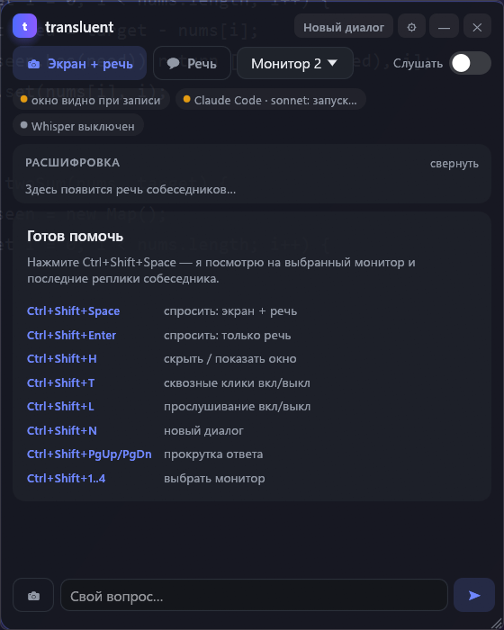

# transluent

Полупрозрачный оверлей-ассистент для Windows (Rust + egui).

- Окно поверх всех, скрыто от захвата экрана (`WDA_EXCLUDEFROMCAPTURE`), без кнопки на панели задач и в Alt+Tab.
- Слушает системный звук (WASAPI loopback), то есть собеседников. Ваш микрофон не захватывается.
- Речь распознаёт локальный faster-whisper (`stt_server.py`) на видеокарте или процессоре.
- Отвечает агент, которого вы выберете в настройках (см. ниже).
- Скриншот выбранного монитора отправляется вместе с вопросом.



## Агенты

Настройки → «Агент» → «Кто отвечает»:

| Агент | Что нужно | Как работает |
|---|---|---|
| **Claude Code** | Установленный и залогиненный Claude Code | Постоянный процесс `claude -p` в режиме stream-json, работает на вашей подписке без API-ключа |
| **Anthropic API** | Ключ API (в настройках или `ANTHROPIC_API_KEY`) | Messages API с потоковым ответом. По умолчанию `claude-opus-5-5`; при отказе модели по соображениям безопасности API сам повторяет запрос на запасной модели (`fallbacks: "default"`) |
| **OpenAI-совместимый** | Адрес сервера, модель, при необходимости ключ (`OPENAI_API_KEY`) | `/chat/completions` со `stream: true`. Готовые адреса: OpenAI, OpenRouter, Ollama, LM Studio. Для скриншотов нужна модель с поддержкой изображений |
| **Своя команда** | Любая консольная программа | На каждый вопрос запускается команда, вопрос уходит в stdin, stdout показывается как ответ. `{image}` в команде заменяется путём к PNG со скриншотом |

Ключи хранятся только в `%APPDATA%\transluent\config.json`.
Новый агент добавляется в `src/agent.rs`: вариант в `AgentKind` (`src/config.rs`) и реализация трейта `Agent` (`alive` и `send`), ответ отдаётся событиями `AgentDelta` / `AgentDone`.


## Запуск

```
transluent.exe
```

Сборка: `cargo build --release`. Для распознавания речи нужны Python с `faster-whisper`, а для видеокарты ещё `nvidia-cublas-cu12` и `nvidia-cudnn-cu12`.
`stt_server.py` должен лежать рядом с exe (в релизном архиве он уже там).

## Горячие клавиши

| Клавиши | Действие |
|---|---|
| Ctrl+Shift+Space | спросить: скриншот монитора + новые реплики |
| Ctrl+Shift+Enter | спросить: только новые реплики |
| Ctrl+Shift+H | скрыть / показать окно |
| Ctrl+Shift+T | сквозные клики (окно не перехватывает мышь) |
| Ctrl+Shift+L | прослушивание вкл/выкл |
| Ctrl+Shift+N | новый диалог |
| Ctrl+Shift+PgUp / PgDn | прокрутка ответа |
| Ctrl+Shift+1..4 | выбрать монитор |

## Файлы

- Настройки и лог: `%APPDATA%\transluent\` (`config.json`, `transluent.log`)
- Для отладки: `TRANSLUENT_SHOW_IN_CAPTURE=1` делает окно видимым на скриншотах.
- Оформление — общий с остальными утилитами набора `src/theme.rs`.

## Обновления и NIMVORO

Утилита входит в набор [NIMVORO](https://github.com/GrigoryyKach/nimvoro): лаунчер ставит её в один клик и обновляет.
При запуске программа проверяет последний [релиз](https://github.com/GrigoryyKach/transluent/releases/latest) (переключатель «Проверять обновления при запуске» в настройках, вкладка «О программе»).
Если есть новая версия, кнопка «Обновить» передаёт обновление лаунчеру, а без лаунчера открывает страницу релиза.

Релиз собирается GitHub Actions при пуше тега: поднимите версию в `Cargo.toml`, затем `git tag v{версия} && git push --tags`.
