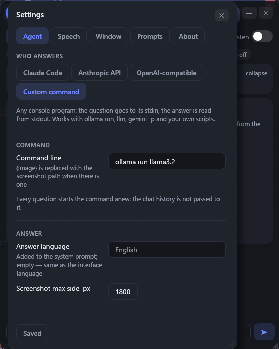
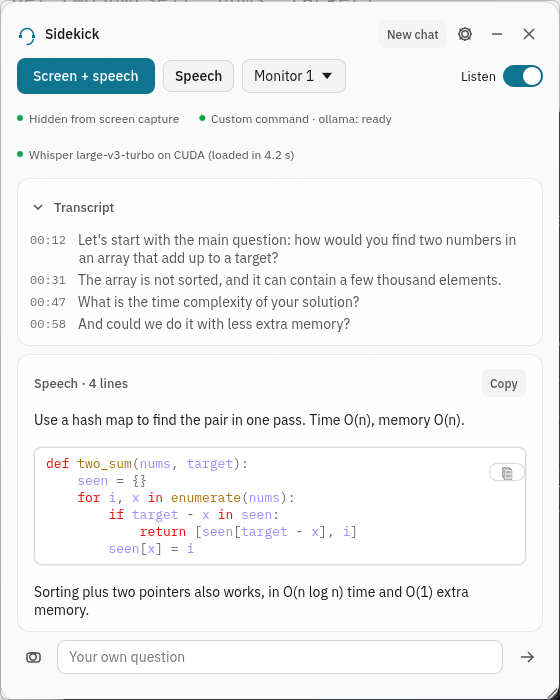

# Sidekick

A translucent overlay assistant for Windows and Linux (Rust + egui), formerly known as transluent.

- An always-on-top window that is hidden from screen capture (`WDA_EXCLUDEFROMCAPTURE`), with no taskbar button and no Alt+Tab entry. **Windows only**: Linux has no way to hide a window from screen sharing (see Platforms).
- It listens to the system audio (WASAPI loopback on Windows, the PulseAudio/PipeWire monitor on Linux), that is, to the other participants. Your microphone is never captured.
- Speech is recognised locally by faster-whisper (`stt_server.py`) on a GPU or CPU.
- The answers come from the agent you pick in Settings (see below).
- A screenshot of the selected monitor is sent along with the question.
- Text in the transcript and in the answers can be selected and copied. The mouse cursor always stays the default arrow, so it never gives the overlay away.


## Languages

The interface and the error messages are available in English (default), Russian and Ukrainian. Pick the language in Settings → Window → Appearance; it applies immediately.
The starting language is taken from the app config, then from the `.nimvoro.json` marker next to the exe (written by the NIMVORO launcher), and falls back to English.

## Theme

Settings → Window → Appearance → Theme: System (default, follows the Windows setting live; on Linux it follows the desktop setting), Light or Dark.

## Agents

Settings → Agent → "Who answers":

| Agent | What you need | How it works |
|---|---|---|
| **Claude Code** | Claude Code installed and signed in | A persistent `claude -p` process in stream-json mode; it runs on your subscription, no API key |
| **Anthropic API** | An API key (in Settings or `ANTHROPIC_API_KEY`) | Messages API with a streamed answer. The default is `claude-opus-5-5`; if the model declines for safety reasons, the API retries on a fallback model itself (`fallbacks: "default"`) |
| **OpenAI-compatible** | Server address, model and, if needed, a key (`OPENAI_API_KEY`) | `/chat/completions` with `stream: true`. Presets: OpenAI, OpenRouter, Ollama, LM Studio. Screenshots need a model with image support |
| **Custom command** | Any console program | The command runs for every question, the question goes to stdin and stdout is shown as the answer. `{image}` in the command is replaced with the path to a PNG screenshot |

Keys are stored only in `%APPDATA%\Sidekick\config.json` (`~/.config/Sidekick/config.json` on Linux).
To add a new agent, add a variant to `AgentKind` (`src/config.rs`) and implement the `Agent` trait (`alive` and `send`) in `src/agent.rs`; the answer is delivered through the `AgentDelta` / `AgentDone` events.



## Run

```
Sidekick.exe
```

Build with `cargo build --release`. Speech recognition needs Python with `faster-whisper`, and a GPU also needs `nvidia-cublas-cu12` and `nvidia-cudnn-cu12`.
`stt_server.py` must sit next to the exe (it is already there in the release archive).

## Platforms

- **Windows** 10 2004+ / 11 x64: `Sidekick-win-x64.zip` from the release, or via the NIMVORO launcher.
- **Linux** x86_64, X11 and Wayland (built on Ubuntu 22.04, glibc 2.35 or newer): `Sidekick-linux-x64.tar.gz` from the release, or via the NIMVORO launcher.

### Linux

Unpack the archive and run `./sidekick`; keep `stt_server.py` next to it. To build from source:

```bash
sudo apt install build-essential pkg-config libxkbcommon-dev libwayland-dev libx11-dev libxcb1-dev
cargo build --release
```

What differs from Windows:

- **Not hidden from screen sharing.** There is no Linux equivalent of `SetWindowDisplayAffinity`. The window stays always on top (X11; on Wayland the compositor decides)
  but it is visible when you share your screen. The status chip says so and its tooltip explains why. Use the window only when you are not sharing,
  or move it to a monitor that is not shared. The taskbar / Alt+Tab entry cannot be removed either.
- **Audio** is captured with `parec` (package `pulseaudio-utils`, also works with `pipewire-pulse`) from the monitor of the default output, so only what you hear is recorded.
- **Screenshots.** X11: read directly, per RandR monitor. Wayland: programs cannot read the screen, so the first of `grim` (wlroots), `gnome-screenshot` (GNOME) or `spectacle` (KDE) that works is used;
  the monitor picker is a single "Monitor 1" there. Not verified on a live Wayland session.
- **Hotkeys** (below) are global on X11 only. Wayland gives programs no global hotkeys, so use the buttons in the window; the log says so.
- **Speech recognition**: set the Python path to `python3` (the default on Linux) with `faster-whisper` installed. The custom-command agent runs through `sh -c`.
- **Claude Code** is looked up as `claude` in `PATH` and in `~/.local/bin`.
- **Window**: click-through (Ctrl+Shift+T) and always-on-top depend on the window manager; Wayland compositors may ignore always-on-top.

## Hotkeys

| Keys | Action |
|---|---|
| Ctrl+Shift+Space | ask: monitor screenshot + new lines |
| Ctrl+Shift+Enter | ask: new lines only |
| Ctrl+Shift+H | hide / show the window |
| Ctrl+Shift+T | click-through (the window does not catch the mouse) |
| Ctrl+Shift+L | listening on/off |
| Ctrl+Shift+N | new chat |
| Ctrl+Shift+PgUp / PgDn | scroll the answer |
| Ctrl+Shift+1..4 | pick the monitor |

On Linux the hotkeys work on X11 only.



## Files

- Settings and log: `%APPDATA%\Sidekick\` on Windows, `~/.config/Sidekick/` on Linux (`config.json`, `sidekick.log`). On the first start after the rename from transluent, `config.json` is copied over from `%APPDATA%\transluent\`; the old folder is left untouched.
- For debugging: `SIDEKICK_SHOW_IN_CAPTURE=1` makes the window visible in screenshots, `SIDEKICK_DATA_DIR` points the app at another settings folder, and `SIDEKICK_DEMO=1` fills the window with demo transcript lines for screenshots (never set it in normal use).
- The look comes from `src/theme.rs`, `src/i18n.rs` and `src/nimvoro.rs`, which are shared byte for byte with the other NIMVORO tools.

## Updates and NIMVORO

The tool is part of the [NIMVORO](https://github.com/GrigoryyKach/nimvoro) suite: the launcher installs and updates it in one click.
On startup the app checks the latest [release](https://github.com/GrigoryyKach/sidekick/releases/latest) (the "Check on startup" switch in Settings → About).
When a new version is available, the Update button hands the update to the launcher, or opens the release page if there is no launcher.

A release is built by GitHub Actions when a tag is pushed (a Windows job and a Linux job, one release with both assets): bump the version in `Cargo.toml`, then `git tag v{version} && git push --tags`.

## Support

If you find this app useful, you can support its development: <https://donatello.to/MicsGame>
